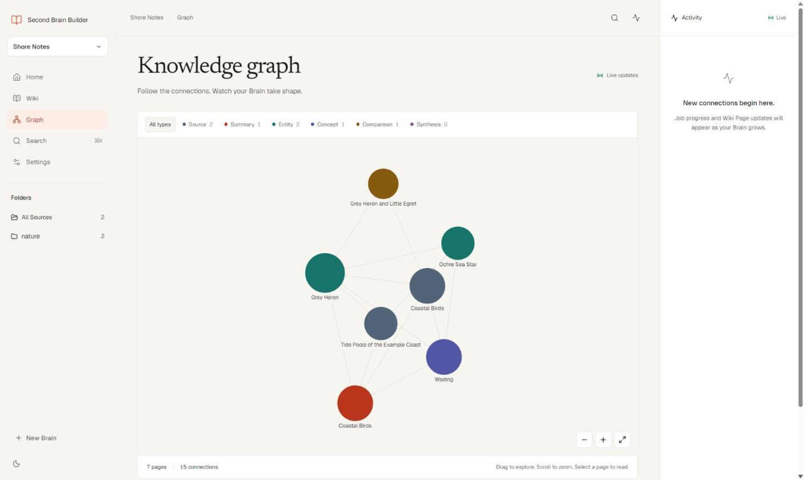
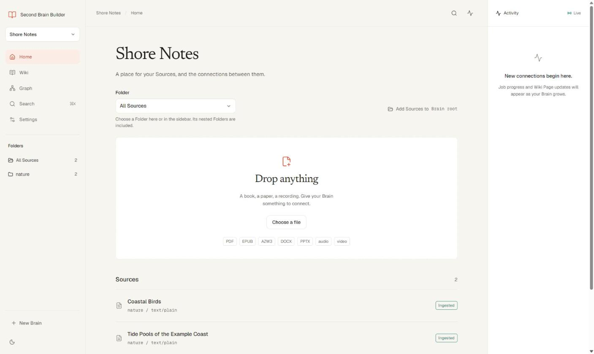
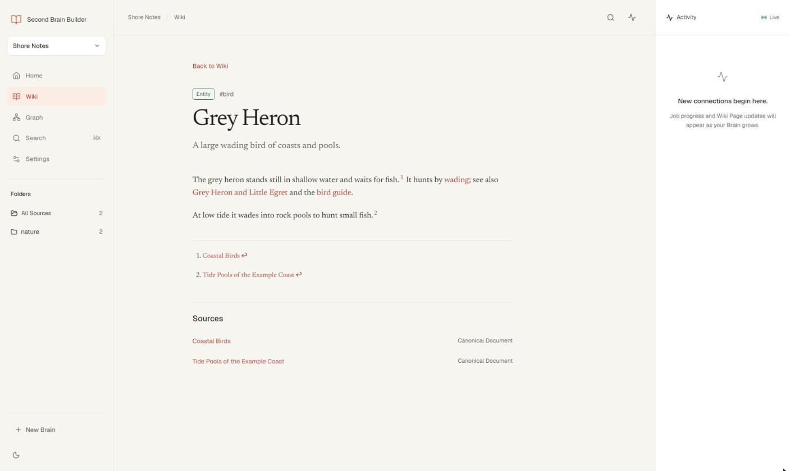
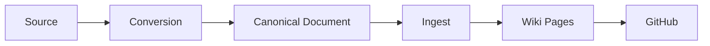

# Second Brain Builder

Turn your documents into a living, LLM-maintained wiki in your own GitHub repo, shared by you and your agents.

[](https://github.com/lincolnminto/second-brain-builder/actions/workflows/ci.yml)
[](LICENSE)
[](pyproject.toml)

<picture>
  <source media="(prefers-color-scheme: dark)" srcset="docs/assets/graph-dark.jpg">
  <source media="(prefers-color-scheme: light)" srcset="docs/assets/graph-light.jpg">
  
</picture>

## Quick start

You need Git and Docker with Compose 2.24+.

```sh
git clone https://github.com/lincolnminto/second-brain-builder.git
cd second-brain-builder
docker compose up -d --build
```

Open [http://localhost:8484](http://localhost:8484). Compose starts the `app` and CPU `worker` services and binds the app to your machine's loopback interface.

In onboarding, connect GitHub, choose a private repository for your **Brain**, and add a local or cloud **Provider** for Ingest. Then drop in your first file. Without a Provider, you can still convert Sources to Markdown; Wiki Page generation needs a configured Ingest Provider and model.

The project GitHub App is not registered yet. Use a fine-grained personal access token with Contents read/write access to an existing repository. First builds install conversion tools; models download on first use.

See [container setup](docker/README.md) for GPU support and storage, and [configuration](docs/architecture.md#configuration) for instance settings.

## Features

- **Keep the originals.** Each Source has a faithful Markdown Canonical Document and extracted Assets. Original files use Git LFS.
- **Build connections as you add Sources.** Ingest writes summaries, entities, concepts, and comparisons with citations to your Canonical Documents.
- **Find and inspect the evidence.** Search page text, follow citations, and explore links in a live graph of Wiki Pages.
- **Share context with your agents.** MCP tools let agents search, read, add Sources, and save cited answers as synthesis pages.
- **Keep a readable history.** Sources and Wiki Pages live together in your GitHub repository, with commits, an index, and a change log.

### Add Sources and follow their progress



### Read Wiki Pages and trace their Sources



## How it works



Conversion extracts Markdown and Assets without an LLM rewrite. Ingest uses your configured Provider to read the Canonical Document and update the wiki. The worker commits and pushes both the converted Source content and the Wiki Pages to GitHub.

Each Brain is one GitHub repository. Folders group Sources inside a Brain; Wiki Pages connect knowledge across those Folders. See the [glossary](GLOSSARY.md) and [architecture](docs/architecture.md) for the full model.

## Supported formats

| Source | Formats | Conversion output |
| --- | --- | --- |
| Documents | PDF, DOCX, PPTX, XLSX | Markdown and extracted Assets |
| Text and web files | Markdown, plain text, CSV, HTML, XHTML | Markdown |
| Ebooks | EPUB, MOBI, AZW3 | Markdown and extracted Assets; Kindle formats go through Calibre |
| Images | PNG, JPEG, TIFF, BMP, WebP, GIF | Markdown with OCR text |
| Audio | WAV, MP3, M4A, AAC, Ogg, FLAC | Timestamped transcript and VTT subtitles |
| Video | MP4, AVI, MOV, MKV, WebM | Transcript, scene-change frames, and frame OCR |

DRM-protected ebooks are rejected. Audio uses local Whisper by default, or an OpenAI-compatible transcription Provider you select. HTML support means file conversion; it does not fetch websites.

## Connect your agent

### MCP

Create an API token in **Settings → API tokens** and copy it when shown. Replace `<API_TOKEN>` below with that token. Run the command in the project where you use Claude Code:

```sh
claude mcp add --transport http second-brain http://localhost:8484/mcp \
  --header "Authorization: Bearer <API_TOKEN>"
```

This uses [Claude Code's HTTP transport](https://code.claude.com/docs/en/mcp#option-1-add-a-remote-http-server). Other MCP clients can use the same Streamable HTTP URL and Bearer header. The client must be able to reach the machine running the app.

Available tools: `list_brains`, `search`, `read_page`, `add_source`, and `save_answer`. Writes return a job id; the worker performs the change and publishes it to GitHub.

### Agent skill

Install the [second-brain skill](skills/second-brain/SKILL.md) with the [Skills CLI](https://github.com/vercel-labs/skills):

```sh
npx skills add lincolnminto/second-brain-builder --skill second-brain
```

The skill teaches agents to search first and cite Sources. It uses MCP when connected and can read a local Brain clone when MCP is unavailable. Writes go through MCP.

## Privacy

- **Local-first processing.** Conversion, the search index, and the job queue run on your machine. Ingest sends content to the Provider you configure, which can run locally or in the cloud. A selected transcription Provider also receives audio.
- **Private repositories by default.** New Brain repositories are private. Connecting an existing public repository requires confirmation. Every Brain requires GitHub; original Sources, Canonical Documents, and Wiki Pages are published to that repository.
- **No application telemetry.** The app has no analytics, and the worker disables Hugging Face telemetry by default. GitHub and your selected Providers have their own data policies.
- **Encrypted credentials.** GitHub and Provider credentials use Fernet encryption at rest. API tokens are stored as hashes and shown once. Protect the local data volume: it also holds the encryption key, and document content is not encrypted by the app.

See the [security policy](SECURITY.md) to report a vulnerability privately.

## Why OKF v0.3?

Your Brain stays portable. [Open Knowledge Format v0.3](https://github.com/open-knowledge-format/open-knowledge-format/blob/main/SPEC.md) uses Markdown files, YAML frontmatter, standard Markdown links, and source citations. You and your agents can read the repository with ordinary file and Git tools.

Second Brain Builder validates a strict OKF v0.3 profile and records the format version in each Brain. The app requires GitHub, but the knowledge files remain readable without the app. See [the format decision](docs/adr/0001-strict-okf-v0-3.md).

## Roadmap

- [ ] Register the project GitHub App so onboarding can offer device sign-in without instance-specific setup.
- [ ] Publish a recorded walkthrough from the first Source to a connected wiki.
- [ ] Add translated READMEs after the English guide is stable.

## Contributing

Read [CONTRIBUTING.md](CONTRIBUTING.md) for setup, checks, and contribution rules. Use synthetic data in examples and reports. This project follows the [Contributor Covenant](CODE_OF_CONDUCT.md) and uses the [MIT license](LICENSE).

If you want your documents and agents to share a wiki you own, [star the repository](https://github.com/lincolnminto/second-brain-builder).

## Star History

[](https://www.star-history.com/#lincolnminto/second-brain-builder&Date)
